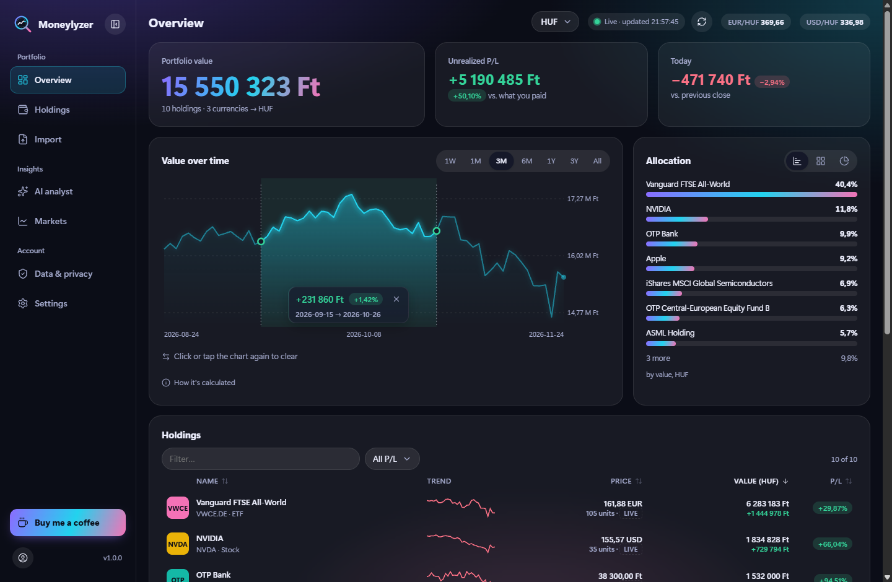
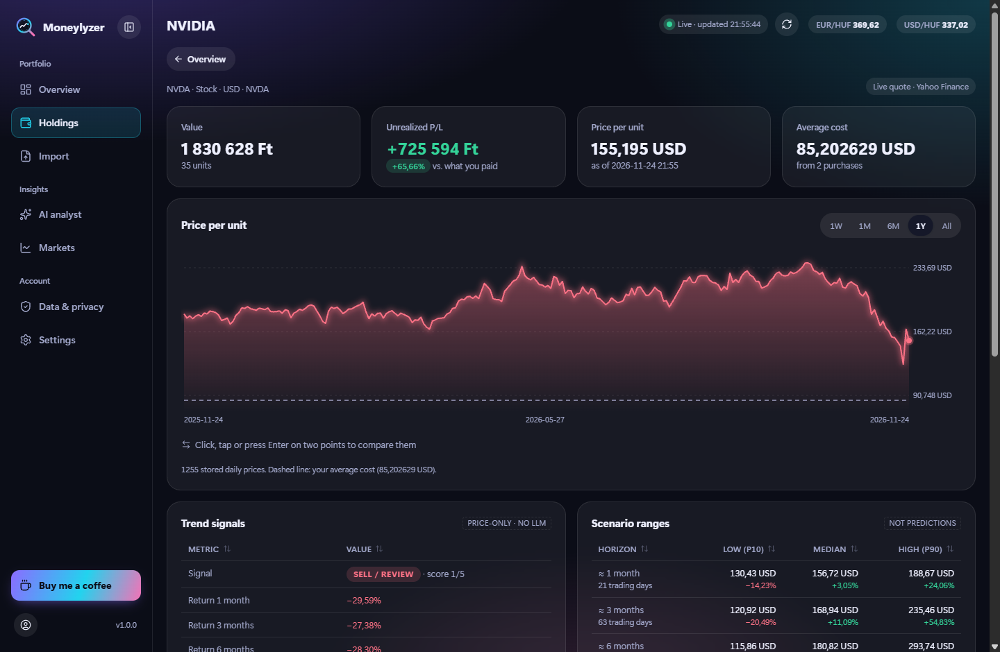
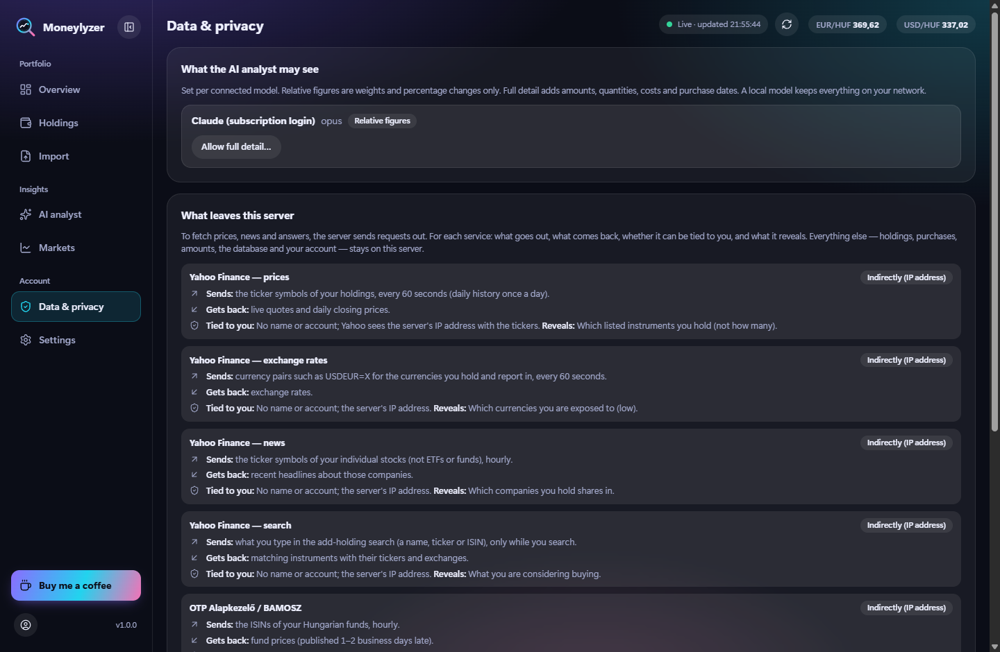
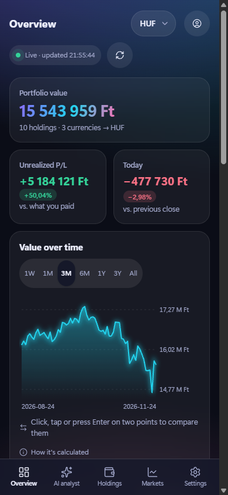

# Moneylyzer

[](LICENSE) [](https://revolut.me/vargamolnarb)

A private, self-hosted dashboard for your own investments: live value and profit/loss in the currency
you choose, every purchase you made, charts, trend signals, market context and an AI analyst you
connect yourself. One Docker image; your data stays in one SQLite file on your own machine.
It is **not** a broker connection, a trading tool or financial advice.



> **Not financial advice.** Moneylyzer is a free, self-hosted tool for your own records and research.
> Nothing it shows is investment, tax or legal advice from its author. AI-generated text, including
> recommendations if you turn them on, comes from the AI model you connect, unverified and not a
> suitability assessment by a licensed adviser. You decide and are responsible for your investments;
> the software comes "as is" and, as far as the law allows, its author is not liable for your losses.
> Full notice: [DISCLAIMER.md](DISCLAIMER.md).

## What it does

- **Live overview**: total value, unrealized P/L and today's change, refreshed every minute (15 s to
  15 min in Settings) and pushed to every open tab; live quotes pause while no tab is open. Value over time for 1 week to all time; click two points on any chart to
  see the change between them. Allocation as bars, a treemap or a donut.
- **Any display currency**: holdings in EUR, USD, HUF or anything Yahoo quotes are converted at each
  day's exchange rate, so history and P/L are right in the currency you pick.
- **Transactions**: record each buy and sell (date, units, price, optionally what you actually paid or
  received and where). P/L then matches your broker; sales use up the oldest buys first (FIFO), giving
  a realized P/L per sale and per holding next to the unrealized one, and a holding you sold completely
  becomes "Closed". The add-holding wizard looks up tickers and ISINs for you.
- **Analysis per holding**: returns, drawdown, volatility, RSI, moving averages, a transparent
  price-trend signal and historical scenario ranges (clearly labelled: not predictions).
- **Markets**: indices, rates, gold, oil, currencies and crypto for context, plus recent news about
  what you hold.
- **AI analyst** (optional): ask about your portfolio, a holding or the markets. Connect your Claude
  subscription, an API key (Claude, OpenAI, Gemini, Mistral, Groq, OpenRouter, DeepSeek, xAI) or a
  local model (Ollama, LM Studio, llama.cpp). By default a model sees only weights, percentage
  changes and whether a holding is sold out; you can allow full detail per model. Your own standing rules and persona shape every answer.
- **Data & privacy page**: every request the server makes, what it sends, whether it can be tied to
  you and what it reveals.
- **Works on your phone**: responsive down to phone width with a bottom tab bar; dark and light
  themes; animations you can turn down in Settings.

| Holding detail | Data & privacy | Phone |
|---|---|---|
|  |  |  |

## Run it

You need [Docker](https://docs.docker.com/get-docker/) (Docker Desktop on Windows or macOS).

```sh
git clone https://github.com/vargamolnarbertalan/moneylyzer.git
cd moneylyzer
docker compose up -d --build
docker logs moneylyzer        # shows the one-time setup code on first start
```

1. Open <http://localhost:8080>, enter the setup code from the log, then choose a username and a
   password (10+ characters). Accept the "not financial advice" notice.
2. Add holdings with **Holdings → Add holding**, or import CSV files on **Import**.
3. Prices appear within a minute. Add more purchases on a holding's page.
4. Optional: **Settings → AI models** to connect a model for the AI analyst.

Stop: `docker compose down` (your data is kept). Update: `git pull`, then `docker compose up -d --build`.

### From your phone

The compose file publishes port 8080 on your network, so on the same Wi-Fi open
`http://<this computer's IP>:8080`. If your firewall asks, allow Docker for **private** networks only.
Everyone on that network can reach the sign-in page, so use a strong password. Traffic is plain HTTP
inside your home network; don't expose the port to the internet (put it behind an HTTPS reverse proxy
and set `LIA_COOKIE_SECURE=1` if you need remote access). For this-computer-only access change the
port line to `"127.0.0.1:8080:8080"`.

## Importing CSV files

Import in this order: holdings first, then transactions and price history, which refer to holdings by
`instrument_id`. Each card on the **Import** page offers a template.

| File | First line |
|---|---|
| Holdings | `instrument_id,name,asset_type,quantity,avg_cost,currency,market_symbol,price_divisor,notes` |
| Transactions | `instrument_id,buy_date,side,quantity,unit_price,paid_amount,paid_currency,platform,notes` |
| Price history | `instrument_id,date,close,currency` |

- `asset_type`: `stock`, `etf`, `mutual_fund`, `government_bond` or `commodity`.
- `market_symbol`: a Yahoo ticker (`VWCE.DE`, `AAPL`, `GC=F`) or `fund:<ISIN>` for Hungarian funds
  (priced from OTP Alapkezelő, falling back to BAMOSZ). Price history is for holdings no source covers.
- `price_divisor`: `1`, or `100` for bonds quoted per 100 nominal.
- Transactions: `buy_date` (the trade date) as `YYYY-MM-DD`; `side` is `buy` or `sell` (empty means
  buy, so older files still work); `paid_amount`/`paid_currency` (fees included for a buy, net of fees
  for a sell) make P/L match your broker exactly. A sale larger than the units held on its date is
  refused with its line number. Importing the same file twice skips exact duplicates.

## What leaves your computer

The **Data & privacy** page in the app lists every outgoing request in detail. In short:

- Ticker symbols and currency pairs go to Yahoo Finance (prices every minute while the app is open in a
  browser, history daily, news hourly,
  a holding's minute or hour prices while its chart shows them, and what you type in the add-holding
  search); fund ISINs go to OTP Alapkezelő / BAMOSZ.
- Your question goes to the AI model you connected, only when you ask, with your AI analyst rules,
  persona and investing preferences, and weights, percentage changes and whether a holding is sold out.
  Amounts, quantities, costs, realized profit, purchase and sale dates, platforms and holding notes are
  sent only to a model you set to full detail. A file you attach to a question goes to that model with
  that question, at either level; the app keeps only its name and size.
- Never sent anywhere: the database, your account, the CSV files you import. The app has no telemetry.

## Your data and backups

Everything lives in the `lia-data` Docker volume: the database, your app account and any AI logins
and keys. **Settings → Your data → Download database backup** gives you a consistent copy. Unknown
values are never shown as 0: a holding without a price or exchange rate is flagged and left out of
the total.

**Before upgrading to the version with sells, download a backup.** The database is migrated in place:
every earlier row becomes a buy. An older version knows nothing about sells, so if you go back to it
after recording a sale, it reads that sale as a purchase.

## Configuration

Set these under `environment:` in `docker-compose.yml`:

| Variable | Default | What it does |
|---|---|---|
| `LIA_DONATE_URL` | the author's link | Empty hides the "Buy me a coffee" button |
| `LIA_COOKIE_SECURE` | off | `1` behind an HTTPS reverse proxy |
| `LIA_LIVE_SECONDS` | `60` | How often live prices are fetched (seconds, rounded to 15/30/60/120/300/900) until a choice is saved in Settings |

## Development

```sh
python3.12 -m venv .venv
.venv/bin/pip install -r requirements-dev.txt          # Windows: .venv\Scripts\pip
.venv/bin/python -m unittest discover -s tests         # backend tests
cd frontend && npm ci && npm run dev                   # UI on :5173, proxies /api to :8080
# in another terminal, from the project root:
LIA_DATA_DIR=./data .venv/bin/python -m uvicorn server.main:app --port 8080
```

Layout: `analyzer/` (data, maths, market sources, AI), `server/` (FastAPI API, live hub, sign-in),
`frontend/` (React + Vite + TypeScript), `tests/`, `scripts/seed_demo.py` (a fictional demo portfolio,
used for the screenshots). `requirements.lock` pins the exact versions the image installs.

## Limitations

- No exchange rate is guessed: a holding without a rate is left out of the total and flagged.
- Realized P/L is first in, first out, with each amount converted at its own day's exchange rate.
- Yahoo quotes for some exchanges are delayed (~15 min); Hungarian fund prices arrive 1–2 business days late.
- Signals are price-trend heuristics only: no fundamentals, valuation, taxes or advice.

## Third-party services and licences

- Market data comes from Yahoo Finance (via the Apache-2.0 [yfinance](https://github.com/ranaroussi/yfinance)
  library), OTP Alapkezelő and BAMOSZ, fetched by **your** installation for your personal use. Their terms
  apply to you; this project does not redistribute their data.
- Connecting a Claude subscription downloads the **Claude Code** CLI from npm the first time (a pinned
  version, checked against npm's integrity hash), and again in the background after an app update pins a
  different version, when you use Claude (signed in, or asking the Claude model). A failed download is
  retried an hour later, then less often, at most daily. Claude Code is Anthropic's software under Anthropic's
  own terms, not MIT; it is not part of this repository or the image. AI providers' terms apply to your
  account with them.
- Everything in this repository is MIT-licensed ([LICENSE](LICENSE)). The built web app bundles React and
  Radix UI (MIT) and Lucide icons (ISC); their licence texts ship with it as `third-party-licenses.txt`
  (Settings → About → Third-party licences).

## Contributing

See [CONTRIBUTING.md](CONTRIBUTING.md) for branches, commit style and the release process, and
[SECURITY.md](SECURITY.md) for reporting vulnerabilities.

## Support the project

If this saves you time, you can [buy me a coffee via Revolut](https://revolut.me/vargamolnarb). ☕

## Disclaimer

Moneylyzer is for personal record keeping and research only. It is not investment, financial, tax or
legal advice from its author. AI-generated analysis and, if you turn them on, AI recommendations come
from the model you connect; they are unverified and not a suitability assessment. Figures can be delayed, incomplete or
wrong and AI output can be wrong; check with your broker and the original sources. You alone decide
and are responsible for your investment decisions. The software is provided "as is", without
warranty; to the fullest extent the law allows, the author and contributors are not liable for any
loss or damage from its use, including lost profits. The app shows this notice before first use. Full text:
[DISCLAIMER.md](DISCLAIMER.md).
